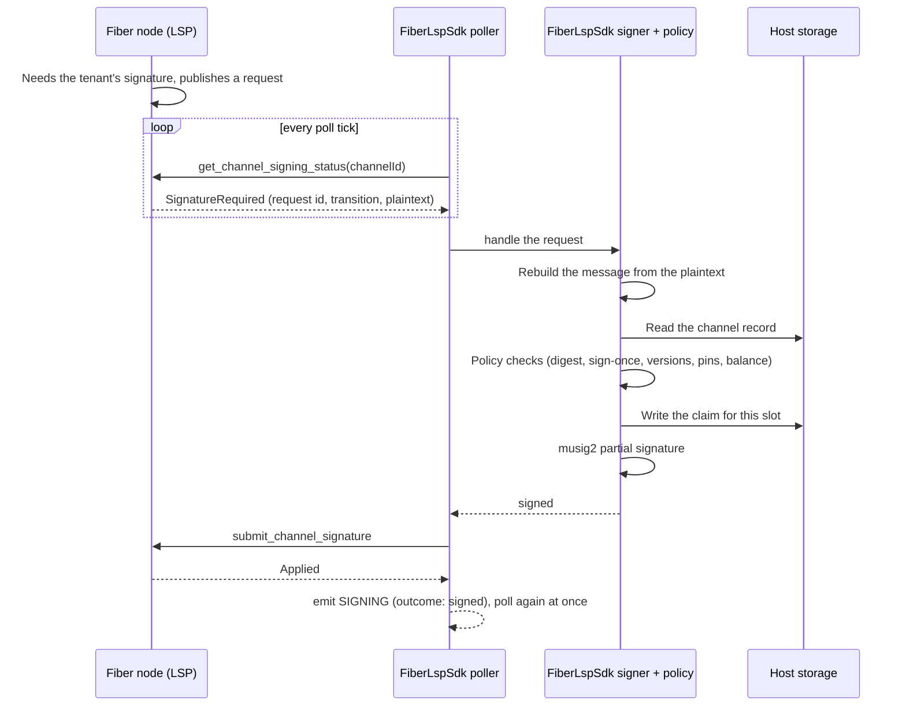
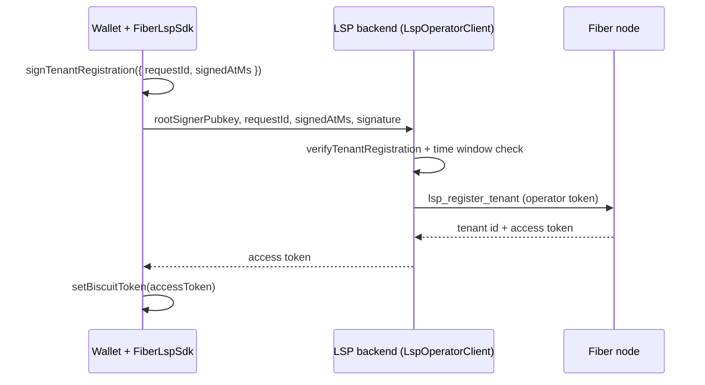

# The hosted-LSP model

The LSP runs the Fiber node, your user's device holds the keys. The SDK is the device's half of that deal: it answers the node's signing requests, and it checks every one before it signs.

## Who does what

A Fiber node is heavy: it must be online all the time, talk to peers, watch the chain and keep channel state. A phone can do none of that reliably. In the hosted-LSP model an LSP (Lightning Service Provider) runs one Fiber node for many users. Each user is a **tenant** on that node: the node keeps the tenant's channels, invoices and payments, and every channel opens between the tenant and the LSP's own node.

What the LSP never gets is the tenant's keys. A channel's funds sit in a 2-of-2 lock, and one of the two keys lives only on the device. Every state change of a channel (a payment, a revocation, a close) needs the device's musig2 partial signature, so the node has to ask for it.

| Party | Runs | Holds |
| --- | --- | --- |
| **The LSP's Fiber node** | The channels, the peer connections, the chain watching, the watchtower | Its own node key and wallet. For each tenant: the channel state, which it builds and stores |
| **The LSP backend** | The operator's API: registering tenants and issuing their tokens | The operator's Biscuit token, which only it may use |
| **The device (your wallet + `FiberLspSdk`)** | The poller, the signing policy | The master seed and everything derived from it: funding keys, nonces, hold invoice preimages |

:::info[What the LSP can and cannot do]
Because the device holds one key of every channel, the LSP cannot move a tenant's funds on its own. It can still refuse service, stall, or force-close a channel (Fiber force-closes on its own when a signature does not arrive in time). And the events the SDK reports about payments are the node's word, not a cryptographic proof. After a force close, the watchtower's spends today pay the LSP's own lock: see [The watchtower](/docs/concepts/watchtower).
:::

## The node asks, the device answers

The node never calls the device. A phone is behind NAT, asleep, or offline half of the time, so the direction is reversed: when the node needs a signature it **publishes a signing request** and waits. The device reads it by polling.

For every channel the device opened, Fiber exposes a signing status (`get_channel_signing_status`): either "nothing to sign", or one pending request with everything the device needs to check it. The SDK's poller reads that status on every tick, and when there is a request it:

1. **Rebuilds the message itself** from the request's plaintext (the transaction or revocation being signed), so it never signs a hash it was handed.
2. **Runs the policy checks**: is this a channel the device knows, does the message match, was this slot signed before, does the new state take money the user did not approve.
3. **Claims the slot** in storage, then signs with a nonce derived from the master seed.
4. **Submits** the partial signature (`submit_channel_signature`), and reports a `SIGNING` event.



A refused request is never submitted: it stays pending on the node, and the SDK reports it as a `SIGNING` event with `outcome: "refused"`. [No blind signing](/docs/concepts/no-blind-signing) explains each check, and [The poller and events](/docs/concepts/poller-and-events) explains the tick.

:::warning[The device has to be online for a round to finish]
A signing round has several steps, and Fiber force-closes a channel when the device goes silent in the middle of one for about 30 seconds. Keep the app polling while a payment is in flight. See [Backgrounding](/docs/guides/backgrounding).
:::

## Tenants and tokens

The tenant API is authenticated with Biscuit tokens, and there are two kinds:

- **The operator token** belongs to the LSP backend. It is the only token that can call `lsp_register_tenant`. It must never ship in an app.
- **The tenant token** (the `accessToken` returned at registration) is what the device puts in `biscuitToken`. It allows the tenant API: channels, invoices, payments and the two signing statuses.

A device becomes a tenant by registering its **RootSigner**, a key the SDK derives from the master seed. Because it is derived, a wallet restored from the same mnemonic lands on the same tenant. The registration is split so that the operator token stays on your server:



The step-by-step version, with the code for both sides, is in [Register a tenant](/docs/guides/register-a-tenant).

## What the device needs to know

Constructing the SDK ties those pieces together: the network, the node's address, the LSP node's public key (every channel opens to it, and the registration is signed for it) and the tenant token once you have it.

```ts title="wallet.ts"
import { FiberLspSdk, type IAsyncSignerStorage } from "@peersyst/fiber-lsp-sdk";

const sdk = new FiberLspSdk(masterSeed, {
    network: "testnet",
    storage,
    rpcUrl: "https://lsp.example.com/rpc", // the tenant API of the LSP's node
    lspPubkey, // the LSP node's 33-byte key: the peer of every channel
    biscuitToken: accessToken, // the tenant token your backend got at registration
});

sdk.connect(); // start answering the node's signing requests
```

You can build the SDK before registering and call [`setBiscuitToken`](/docs/api/classes/FiberLspSdk#setbiscuittoken) later. Every option is described in [Options](/docs/reference/options).

:::note[Pre-release]
The SDK tracks Fiber's hosted-LSP work, which is still in progress, and its API is not settled. Some flows stop under Fiber's current nonce handling. See [Status](/docs/resources/status).
:::

## Next steps

<CardGrid>
  <Card icon="key" title="Keys and recovery" to="/docs/concepts/keys-and-recovery">Where every key comes from, and what a restore brings back.</Card>
  <Card icon="shield" title="No blind signing" to="/docs/concepts/no-blind-signing">The checks every signature passes.</Card>
  <Card icon="rocket" title="Quickstart" to="/docs/get-started/quickstart">Build an SDK instance and open a channel.</Card>
</CardGrid>
