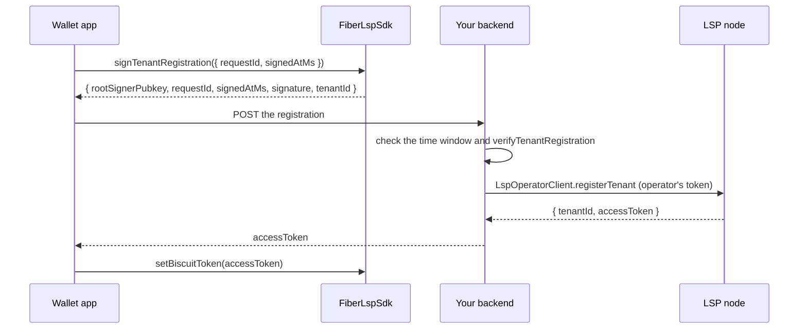

# Register a tenant

Before a device can open channels or move payments, the hosted LSP has to know it as a tenant. The device signs a registration with a key derived from its master seed, your backend checks it and registers it with the LSP, and the device gets back the access token it calls the node with.

## What you'll do

- On the device: sign a registration with `signTenantRegistration` and send it to your backend.
- On the backend: check the signing time and the signature, then call `LspOperatorClient.registerTenant`.
- On the device again: install the access token with `setBiscuitToken`, and keep it for the next start.

The split exists because registering a tenant takes the LSP **operator's token**, which grants the right to create tenants. That token is a backend secret. It never goes on a phone, and the device SDK never makes the call.



## Prerequisites

- A `FiberLspSdk` instance on the device, built with the LSP's `lspPubkey` (see the [quickstart](/docs/get-started/quickstart)). It does not need a `biscuitToken` yet.
- A backend endpoint of your own that the app can reach, and the LSP operator's token stored there.
- The LSP node's public key on the backend too: the registration is signed for one specific LSP.

## Step 1: Sign the registration on the device

`signTenantRegistration` takes two values that you pick:

- `requestId`: 32 fresh random bytes. The node accepts each request id **once**, so never reuse one.
- `signedAtMs`: the current time in Unix milliseconds, as a `bigint`.

The SDK never draws randomness or reads the clock for this, so the call is synchronous and fully determined by its inputs. It signs for the `lspPubkey` the SDK was built with and returns the four fields the LSP's registration method takes, plus the `tenantId` they register.

```ts title="register.ts"
// The registration carries bytes and a bigint, which JSON cannot hold as they are.
const toHex = (bytes: Uint8Array): string => Array.from(bytes, (byte) => byte.toString(16).padStart(2, "0")).join("");

// 1. Pick a fresh request id and the signing time. The SDK draws no randomness and reads no clock here.
const requestId = crypto.getRandomValues(new Uint8Array(32));
const signedAtMs = BigInt(Date.now());

// 2. Sign the registration for the LSP the SDK was built with.
const registration = sdk.signTenantRegistration({ requestId, signedAtMs });

// 3. Send it to your backend, which holds the operator's token.
const response = await fetch("https://wallet-backend.example.com/tenants", {
    method: "POST",
    headers: { "content-type": "application/json" },
    body: JSON.stringify({
        rootSignerPubkey: toHex(registration.rootSignerPubkey),
        requestId: toHex(registration.requestId),
        signedAtMs: registration.signedAtMs.toString(),
        signature: toHex(registration.signature),
    }),
});
const { accessToken } = (await response.json()) as { accessToken: string };

// 4. Hand the tenant's token to the SDK, and keep it for the next start.
sdk.setBiscuitToken(accessToken);
await saveToken(accessToken);
```

:::tip
`crypto.getRandomValues` works in Node and browsers. React Native's Hermes needs a polyfill for it; any cryptographically secure source of 32 bytes will do.
:::

How you encode the registration between app and backend is up to you. The SDK gives you `Uint8Array`s and a `bigint`; the example uses hex and a decimal string.

## Step 2: Check and register it on the backend

The backend checks two things before it spends a call on the node:

1. **The time window.** The node accepts a `signedAtMs` from 5 minutes behind its clock (`TENANT_REGISTRY_MAX_SIGNED_AT_AGE_MS`, `300_000n`) to 30 seconds ahead of it (`TENANT_REGISTRY_MAX_SIGNED_AT_FUTURE_SKEW_MS`, `30_000n`), both bounds included. Both constants are `bigint`s, so you compare them with `signedAtMs` directly.
2. **The signature.** `verifyTenantRegistration(lspPubkey, registration)` checks it exactly as the node does. It returns `false` for a well-formed registration that does not verify, and throws a `TypeError` or `RangeError` naming the field (`registration.signature`, ...) for a malformed one.

Then `LspOperatorClient.registerTenant` sends the registration under the operator's token. It refuses an answer that names another tenant than the key it registered, so the token you hand back is always the device's own.

```ts title="backend/register-device.ts"
import {
    LspOperatorClient,
    TENANT_REGISTRY_MAX_SIGNED_AT_AGE_MS,
    TENANT_REGISTRY_MAX_SIGNED_AT_FUTURE_SKEW_MS,
    verifyTenantRegistration,
} from "@peersyst/fiber-lsp-sdk";
import type { RegisterTenantParams } from "@peersyst/fiber-lsp-sdk";

const fromHex = (hex: string): Uint8Array => Uint8Array.from(hex.match(/../g) ?? [], (pair) => parseInt(pair, 16));

// Built once, at startup. The operator's token never leaves the backend.
const operator = new LspOperatorClient({
    rpcUrl: "https://lsp.example.com/rpc",
    operatorToken: config.operatorToken,
});
const lspPubkey = fromHex(config.lspPubkeyHex);

async function registerDevice(registration: RegisterTenantParams): Promise<{ tenantId: string; accessToken: string }> {
    // 1. Refuse a registration outside fiber's window before spending a call on it.
    const now = BigInt(Date.now());
    const { signedAtMs } = registration;
    if (signedAtMs < now - TENANT_REGISTRY_MAX_SIGNED_AT_AGE_MS || signedAtMs > now + TENANT_REGISTRY_MAX_SIGNED_AT_FUTURE_SKEW_MS) {
        throw new Error("stale registration: sign it again");
    }
    // 2. Check the signature, as the node will. A malformed field throws instead of returning false.
    if (!verifyTenantRegistration(lspPubkey, registration)) throw new Error("invalid registration");
    // 3. Register it under the operator's token.
    return operator.registerTenant(registration);
}

const { tenantId, accessToken } = await registerDevice({
    rootSignerPubkey: fromHex(body.rootSignerPubkey),
    requestId: fromHex(body.requestId),
    signedAtMs: BigInt(body.signedAtMs),
    signature: fromHex(body.signature),
});
```

`registerTenant` does not repeat the checks of the window and the signature: they are yours, and the node runs both again anyway. It does check the shape of every field before sending anything.

:::danger[Keep the operator's token on the server]
The operator's token lets its holder register tenants on the LSP. Store it like any other server credential, and never ship it in an app bundle. `LspOperatorClient` keeps it in a private field, so it does not show up when the client is logged or serialized.
:::

## Step 3: Install the token on the device

`setBiscuitToken(token)` puts the token on every node call from the next one on, the poller's included. The SDK keeps it in memory only, so store it yourself (in the platform's secure storage) and pass it back as the `biscuitToken` option at the next start:

```ts title="sdk.ts"
const biscuitToken = (await loadToken()) ?? undefined;
const sdk = new FiberLspSdk(masterSeed, {
    network: "testnet",
    storage,
    rpcUrl: "https://lsp.example.com/rpc",
    lspPubkey,
    biscuitToken, // undefined until the device registers
});
```

A token that cannot go in an HTTP header (anything but printable ASCII without spaces) throws a `TypeError` and leaves the previous token in place. There is no way to remove a token, only to replace it.

## The tenant id

The tenant id is the LSP's name for the device: 64 lowercase hex characters, computed from the device's registration key. Because that key derives from the master seed, a wallet restored from the same seed lands on the same tenant. You can compute it three ways, and all three agree:

```ts title="tenant-id.ts"
import { FiberLspSdk, computeTenantId, deriveTenantId } from "@peersyst/fiber-lsp-sdk";

// On the device, before the SDK exists (to pick the storage namespace, for instance).
const tenantId = deriveTenantId(masterSeed);

// On the device, once it does: the same id.
console.log(sdk.tenantId === tenantId);

// On the backend, from the key a registration names.
console.log(computeTenantId(sdk.rootSignerPubkey) === tenantId);
```

`deriveTenantId` reads the seed and returns only the public id; it keeps nothing. Use `computeTenantId` on the backend when you key your own records by tenant.

## What can go wrong

| Where | Error | What to do |
| --- | --- | --- |
| `signTenantRegistration` | `TypeError` (`request.requestId` is not 32 bytes) or `RangeError` (`request.signedAtMs` is not a u64 `bigint`) | A bug in the call: fix the inputs. |
| Backend window check | Your own error | Ask the device to sign again with a fresh request id and the current time. Check the device's clock if it keeps happening. |
| `verifyTenantRegistration` | Returns `false` | The signature is not the device's, or it was signed for another LSP key. Refuse the request. |
| `verifyTenantRegistration`, `registerTenant` | `TypeError` or `RangeError` naming the field | A malformed registration, usually a decoding bug between app and backend. |
| `registerTenant` | `RpcError` | The node refused: outside its time window, a request id it has already seen, a bad signature, or the operator's token. `message` is the node's text. |
| `registerTenant` | `RpcTransportError` | The call may or may not have run. The request id may be spent, so have the device sign again with a fresh one. |
| `registerTenant` | `RpcResponseError` | The node answered something unreadable, or named another tenant than the one registered. Do not hand that token to the device. |
| `setBiscuitToken` | `TypeError` | The token cannot go in a header. The previous token stays. |

:::note
A registration whose answer is lost is never retried as it is: the node refuses a request id it has seen. Sign a new one.
:::

## Next steps

<CardGrid>
    <Card icon="bolt" title="Open a channel" to="/docs/guides/open-a-channel">
        With the token installed, open the device's first channel to the LSP.
    </Card>
    <Card icon="key" title="Keys and recovery" to="/docs/concepts/keys-and-recovery">
        Where the registration key comes from, and why a restored wallet keeps its tenant.
    </Card>
    <Card icon="server" title="The hosted LSP" to="/docs/concepts/hosted-lsp">
        Who runs what between the device, the LSP node and your backend.
    </Card>
</CardGrid>
