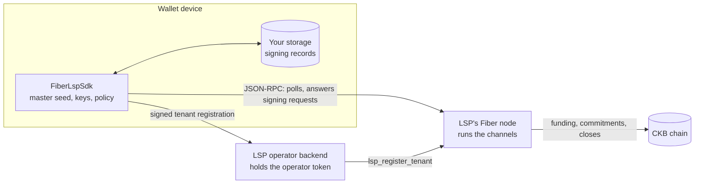

# Introduction

The Fiber LSP SDK turns a wallet into the key holder of [Fiber](https://github.com/nervosnetwork/fiber) channels that a Lightning Service Provider (LSP) hosts for it. The LSP runs the node; your users keep the keys.

## What it is

`@peersyst/fiber-lsp-sdk` is a TypeScript library for the device side of a hosted-LSP integration on Fiber, the Lightning network of Nervos CKB. Running a full Fiber node on a phone is not practical, so the LSP runs one node that hosts many users as tenants. The SDK is what lets each of those users stay in control of their own funds.

The device derives every channel secret from one master seed, answers the node's signing requests with musig2 partial signatures, and enforces a signing policy before each one. It never signs a message it has not rebuilt and checked itself.

## The hosted-LSP model

The work is split between four parties. The LSP node does the networking, routing and bookkeeping. The device holds the keys and signs. The LSP operator's backend admits new tenants. The CKB chain settles opens and closes.

- **The device** runs `FiberLspSdk`. It holds the master seed in memory and keeps its signing records in a storage you provide. It reaches the node only through JSON-RPC, by polling.
- **The LSP node** is a Fiber node with hosted-LSP support. It runs each tenant's channels and, whenever a channel needs a signature, publishes a request that the device answers.
- **The operator backend** holds the operator token, a secret that never ships to devices. It checks a device's signed registration and registers it with the node, which returns the tenant's access token.
- **The CKB chain** holds the funding transaction that your wallet signs, and the transactions that close the channel.

The node never sees a private key, and the device never trusts the node's word for what it signs. Read [the hosted-LSP model](/docs/concepts/hosted-lsp) for the full picture.

## What it gives you

<CardGrid>
<Card icon="key" title="Recoverable keys">
Every channel key is a deterministic function of one master seed, which you derive from the wallet's existing BIP39 seed.
</Card>
<Card icon="shield" title="No blind signing">
The device rebuilds each message from what it knows and checks it against its policy before it signs.
</Card>
<Card icon="lock" title="Sign once">
A persisted record makes sure the same signing slot never gets two different signatures.
</Card>
<Card icon="bolt" title="Channels and payments">
Open a channel, receive on hold invoices, pay invoices through the LSP, and close cooperatively or by force.
</Card>
<Card icon="devices" title="Runs anywhere">
The same package runs in Node, browsers and React Native (Hermes), with no polyfills and four small dependencies.
</Card>
<Card icon="server" title="Operator side included">
The LSP backend verifies and registers tenants with `LspOperatorClient` from the same package.
</Card>
</CardGrid>

:::warning[Pre-release]
The SDK is at version 0.0.0 and its public API is not settled yet. With Fiber's current nonce lifecycle, some payment flows stop and the node force-closes the channel. Read [Status and known limitations](/docs/resources/status) before you build on it.
:::

## Where to go next

<CardGrid>
<Card icon="package" title="Installation" to="/docs/get-started/installation">
Add the package and learn what your app has to provide.
</Card>
<Card icon="rocket" title="Quickstart" to="/docs/get-started/quickstart">
Run a wallet end to end: register, open a channel, receive, pay and close.
</Card>
<Card icon="compass" title="Concepts" to="/docs/concepts/hosted-lsp">
How the device, the node and the operator fit together.
</Card>
<Card icon="book" title="Guides" to="/docs/guides/register-a-tenant">
Step-by-step guides for every operation.
</Card>
<Card icon="code" title="API reference" to="/docs/api/classes/FiberLspSdk">
Every exported class, function and type.
</Card>
<Card icon="eye" title="Security model" to="/docs/resources/security">
What the device trusts, and what it checks instead.
</Card>
</CardGrid>
