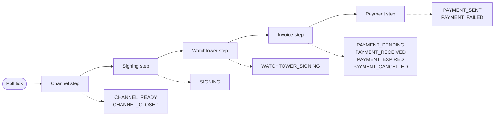

# Events

The SDK tells you what happened to your channels, invoices, payments and signatures through one listener. This page lists every event, its payload, when it fires and how to deduplicate it.

## Subscribing

[`onEvent(listener)`](/docs/api/classes/FiberLspSdk#onevent) subscribes to every event and returns the function that unsubscribes. An event is an [`SdkEvent`](/docs/api/type-aliases/SdkEvent): a `type` from [`SDK_EVENT_TYPES`](/docs/api/variables/SDK_EVENT_TYPES) plus that type's fields, so a `switch` on `event.type` narrows the payload.

```ts title="events.ts"
import type { SdkEvent } from "@peersyst/fiber-lsp-sdk";

// The eight activity events can repeat after a crash: key them by type and id.
function dedupKey(event: SdkEvent): string | null {
    switch (event.type) {
        case "CHANNEL_READY":
        case "CHANNEL_CLOSED":
            return `${event.type}:${event.channelId}`;
        case "PAYMENT_SENT":
        case "PAYMENT_FAILED":
        case "PAYMENT_PENDING":
        case "PAYMENT_RECEIVED":
        case "PAYMENT_EXPIRED":
        case "PAYMENT_CANCELLED":
            return `${event.type}:${event.paymentHashHex}`;
        default:
            return null;
    }
}

const unsubscribe = sdk.onEvent((event) => {
    const key = dedupKey(event);
    if (key !== null) {
        if (seen.has(key)) return;
        seen.add(key);
    }
    if (event.type === "PAYMENT_RECEIVED") notify(`Payment received: ${event.paymentHashHex}`);
});
```

A few rules hold for every listener:

- Whatever your listener throws is swallowed. It never breaks the SDK or the other listeners.
- An event reaches the listeners subscribed when it was raised. A listener added while handling an event gets the next one; a listener removed during an event still hears that event and nothing after.
- Events only come while the instance polls, between [`connect()`](/docs/api/classes/FiberLspSdk#connect) and [`disconnect()`](/docs/api/classes/FiberLspSdk#disconnect). See [Poller and events](/docs/concepts/poller-and-events).

## Where events come from

Each poll tick runs five steps, in this order. Each step emits its own events; any step can emit `ERROR`.



## All events

| Event | Payload | When it fires | Emitted by | Dedup key | At least once |
| --- | --- | --- | --- | --- | --- |
| `CHANNEL_READY` | `channelId: string` | A channel the device opened reached Fiber's `ChannelReady` | Channel step | `type` + `channelId` | Yes |
| `CHANNEL_CLOSED` | `channelId: string` | A channel the device watched reached Fiber's `Closed`, under any flag | Channel step | `type` + `channelId` | Yes |
| `PAYMENT_SENT` | `paymentHashHex: string` | A payment sent with `transfer` succeeded | Payment step | `type` + `paymentHashHex` | Yes |
| `PAYMENT_FAILED` | `paymentHashHex: string`, `reason: string` | A payment sent with `transfer` failed, or never ran | Payment step | `type` + `paymentHashHex` | Yes |
| `PAYMENT_PENDING` | `paymentHashHex: string` | A payment is held on one of your invoices (Fiber's `Received`) | Invoice step | `type` + `paymentHashHex` | Yes |
| `PAYMENT_RECEIVED` | `paymentHashHex: string` | One of your invoices was paid with the preimage the device released (Fiber's `Paid`) | Invoice step | `type` + `paymentHashHex` | Yes |
| `PAYMENT_EXPIRED` | `paymentHashHex: string` | One of your invoices ended unpaid by expiry; its preimage was never released | Invoice step | `type` + `paymentHashHex` | Yes |
| `PAYMENT_CANCELLED` | `paymentHashHex: string` | One of your invoices was cancelled; its preimage was never released | Invoice step | `type` + `paymentHashHex` | Yes |
| `SIGNING` | [see below](#signing) | A signing request was signed (and the node took it) or refused | Signing step | `requestId` | Not recorded; a signature can be announced again |
| `WATCHTOWER_SIGNING` | [see below](#watchtower_signing) | A watchtower spend was signed (and the node took it) or refused | Watchtower step | `requestId` | Not recorded; repeats on every tick while refused |
| `ERROR` | `error: SdkError` | A poll step failed, or one channel, invoice or payment inside a step failed | Any step, or the poller | None (a diagnostic) | Not recorded, not repeated |

Ids are always `0x`-prefixed lowercase hex: `channelId` as Fiber names the channel, `paymentHashHex` as [`createInvoice`](/docs/api/classes/FiberLspSdk#createinvoice) or [`transfer`](/docs/api/classes/FiberLspSdk#transfer) returned it.

## Activity events are at least once

The eight channel and payment events are **at least once**. The SDK emits the event first and records it afterwards, so a crash (or a `disconnect()`) between the two repeats the event on the next tick. Deduplicate on the event's type and id, as in the sample above.

:::tip
Keep your dedup set in durable storage if a duplicate would show the user something twice, like a "payment received" notification after a restart.
:::

Per event:

- **`CHANNEL_READY`** fires once per channel. A channel that later moves to `ShuttingDown` is not announced again until it closes.
- **`CHANNEL_CLOSED`** covers a cooperative close, either side's force close, an abandon, and an opening Fiber aborted before it was funded. It may come with or without a `CHANNEL_READY` before it.
- **`PAYMENT_SENT`** and **`PAYMENT_FAILED`** are both final for a payment. `reason` is Fiber's `failed_error` verbatim (an empty string included), or one of the SDK's own texts: `"the node holds no session of the payment: it was never sent"` when the node has no record of the send, or `"the node reports the payment failed without a reason"` when Fiber gives none. A node can lie about a payment's status; the events report what the node says.
- **`PAYMENT_PENDING`** fires the first time an invoice is seen `Received`. The device then releases the preimage on its own when it is safe to, and `PAYMENT_RECEIVED` follows.
- **`PAYMENT_EXPIRED`** comes two ways: Fiber reports the invoice `Expired`, or it stays `Received` past its expiry with no TLC of it left on any channel.
- **`PAYMENT_CANCELLED`** is Fiber's word whoever cancelled: your own [`cancelInvoice`](/docs/api/classes/FiberLspSdk#cancelinvoice) or anyone else holding the tenant's token.

## `SIGNING`

Fiber's node never calls the device: signing requests wait on the node until the signing step reads them. `SIGNING` reports how each request was answered.

| Field | Type | Meaning |
| --- | --- | --- |
| `channelId` | `string` | The channel the request is for |
| `requestId` | `string \| null` | The node's request id, `0x`-prefixed hex as Fiber writes it (so you can match it in the node's logs). `null` when the status could not be read, or the node answered for another channel |
| `transition` | [`ChannelSigningTransition`](/docs/api/type-aliases/ChannelSigningTransition) `\| null` | Fiber's name for the step: `"SendCommitmentSigned"`, `"CompleteReceivedCommitment"`, `"SendRevokeAndAck"`, `"CompleteReceivedRevokeAndAck"`, `"SendClosingSigned"` or `"SignChannelAnnouncement"`. `null` in the same cases as `requestId` |
| `outcome` | [`SigningEventOutcome`](/docs/api/type-aliases/SigningEventOutcome) | `"signed"`, `"warning"` or `"refused"` (below) |
| `error` | [`SignerRefusal`](/docs/api/type-aliases/SignerRefusal) (`{ code, message }`) | Only when `outcome` is `"refused"`. `code` is one of the [signer error codes](/docs/reference/errors#signer_error_codes) |
| `deadlineMs` | `number`, optional | When Fiber force-closes the channel if the request is still unanswered (below) |

### `outcome`

| Value | Meaning |
| --- | --- |
| `"signed"` | The device signed and the node took the signature. Never emitted before the node accepted it |
| `"warning"` | Signed as well, but as a slot's second session under `nonceReuse: "allow"`. See [Options](/docs/reference/options#fiberlspsdkoptions) |
| `"refused"` | The device refused. Nothing is submitted, and the request stays pending on the node |

### `deadlineMs`

`deadlineMs` is a moment in milliseconds since the epoch, comparable with `Date.now()` (or your `now` option), after which Fiber force-closes the channel if the request is still unanswered. Show it to the user; the SDK never acts on it.

- It is present only on the two commitment transitions whose snapshot lists at least one TLC, on a channel whose delay is pinned. Its absence means the device cannot compute it, **not** that Fiber has no deadline: a revocation, a close or a fulfil's commitment still falls under Fiber's deadline while a TLC's removal is unconfirmed.
- It is an upper bound. Fiber may force-close earlier, never later.
- On a refused request, the expiries it is computed from are the node's own statement, so the bound is only as good as the node is honest.

### Repeats

- A **refusal** is told once per channel, request id and error code, within one instance. A new instance tells it again, and so does the same request refused for another reason. A refusal with `requestId: null` has no request to name and is told on every tick.
- A **signature** is not held to once. While Fiber keeps offering a request it already took, or after a submission whose answer was lost, the device signs it again with the same bytes, resubmits and announces it again. Deduplicate on `requestId` if you show one notification per signature.

```ts title="signing.ts"
sdk.onEvent((event) => {
    if (event.type !== "SIGNING") return;
    if (event.outcome === "refused") {
        log("refused", event.channelId, event.requestId, event.error.code, event.error.message);
    } else if (event.outcome === "warning") {
        log("signed as a second session on a slot", event.channelId, event.transition);
    }
    if (event.deadlineMs !== undefined) showCountdown(event.channelId, event.deadlineMs);
});
```

:::warning
A refused request inside a round's timed part leaves the channel to Fiber's timers, which force-close it 30 seconds later, or up to one of Fiber's channel checks after that. Under Fiber's current nonce lifecycle some rounds are always refused. See [Project status](/docs/resources/status).
:::

## `WATCHTOWER_SIGNING`

After a force close, Fiber's watchtower spends the commitment cell one unlock at a time, each spend waiting on the device's signature.

| Field | Type | Meaning |
| --- | --- | --- |
| `channelId` | `string` | The channel the spend is for |
| `requestId` | `string \| null` | The node's request id, `0x`-prefixed hex. `null` when the status could not be read, or the node answered for another channel |
| `purpose` | [`WatchtowerKeyPurpose`](/docs/api/type-aliases/WatchtowerKeyPurpose) `\| null` | The key the spend needs: `{ kind: "settlement" }` or `{ kind: "tlc", commitmentNumber }`. `null` in the same cases as `requestId` |
| `outcome` | `"signed"` \| `"refused"` | `"signed"` once the node took the signature; `"refused"` otherwise |
| `error` | [`SignerRefusal`](/docs/api/type-aliases/SignerRefusal) | Only when `outcome` is `"refused"` |

It is never held to once: a refused spend is reported on every tick while it waits, and a signed one is announced again when its submission is resent or when Fiber rebuilds a spend of an unlock already signed under a new request id. Deduplicate on `requestId`.

Without a [watchtower approval](/docs/reference/options#sdkwatchtoweroptions), every spend is refused as `policy_refusal`, on every tick. See [Watchtower](/docs/concepts/watchtower).

## `ERROR`

`ERROR` carries one field, `error`, an [`SdkError`](/docs/api/classes/SdkError) whose `code` is always `"poll_failed"`. It exists because a failed poll has no caller to throw to: a node that cannot be reached, an answer that cannot be read, a storage that throws, a step that took longer than 30 seconds, or a host timer that throws when arming the next tick. The `cause` is what was thrown. The SDK retries at the next tick (a timer that throws ends the loop until the next `connect()`).

`ERROR` is neither recorded nor repeated on purpose: treat it as a log line, not as state. See [Errors](/docs/reference/errors).

## See also

- [Poller and events](/docs/concepts/poller-and-events)
- [Handle events and errors](/docs/guides/events-and-errors)
- [Errors](/docs/reference/errors)
- [`SdkEvent` in the API reference](/docs/api/type-aliases/SdkEvent)
